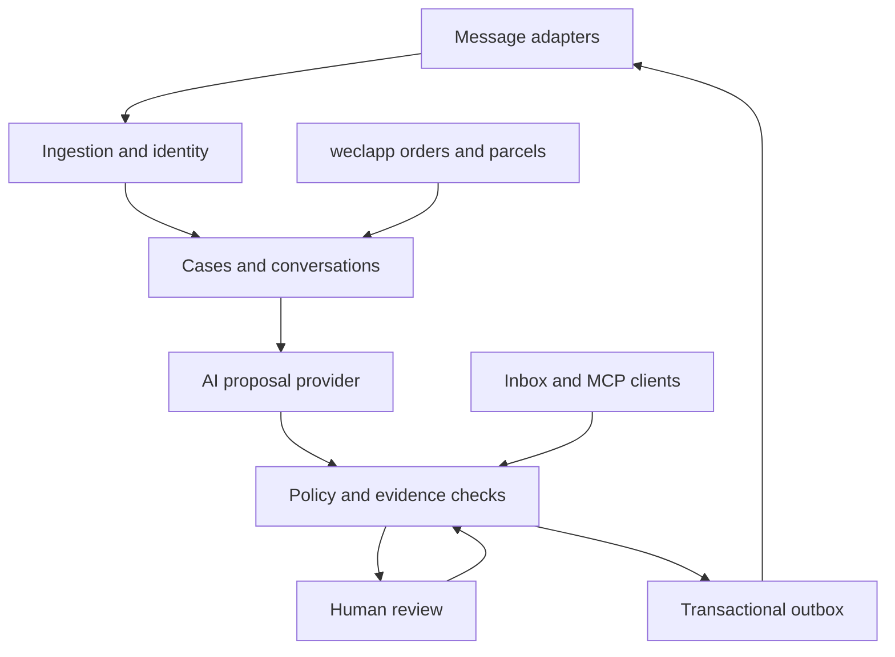

# Architecture decision record

Status: proposed service design, dated 2026-10-21. Only the small core contracts/policy example are implemented in this starter.

## Decision: a modular monolith, two process roles

The project owner has confirmed that all order data already lives in weclapp. **v1 implements weclapp as its sole order-data provider.** Channels supply customer conversations and receive replies; do not add a Shopify Admin API order connector, Amazon order import or DocMorris order import. Keep the generic OrderProvider contract so other self-hosting operators can extend the project later.

DocMorris enquiries arrive by email, as confirmed by the project owner. Ingest them through the shared Microsoft connector from M1, with channel classification and weclapp order matching. A separate DocMorris native API adapter is not required for v1. Store inbound and outbound capabilities separately: receiving an email does not establish a verified reply route.

Use TypeScript across a future Next.js web application, server-side domain services and a dedicated worker. Keep a separate PostgreSQL database for the project. Begin with database-backed jobs and an outbox; add infrastructure only when measurements justify it. Provide private attachment storage behind an interface. Docker Compose is the intended first deployment target, not an included working deployment yet.

The web/API, worker and optional MCP server invoke the same application services. No entry point may bypass account authorization, evidence validation or action policy.

## Boundaries and planned modules

| Module | Responsibility |
| --- | --- |
| `apps/web` | Inbox, case detail, onboarding, configuration and approvals |
| `apps/worker` | Sync, enrichment, AI jobs, outbox and reconciliation |
| `apps/mcp` | Authenticated tools over application services |
| `packages/core` | Identity, contracts, domain state and policy |
| `packages/connectors` | Provider-specific transport and order adapters |
| `packages/ai` | Provider implementations and structured proposal validation |
| `packages/storage` | Transactions, authorization-aware repositories and storage abstractions |

Directories other than the supplied core are planned. They should be introduced with an actual executable slice, not empty success-returning stubs.

## Identity and ownership

Every persisted or executable object belongs to a workspace. A workspace can own multiple merchant accounts and channel connections, mapped to its configured weclapp connection. The provider interface remains extensible for other installations. Derive workspace scope from authenticated identity, never from a client-controlled identifier alone. A queue job carries its verified scope; the worker revalidates it when resolving data or secrets.

Use at least `(workspace, connector instance, external message ID)` for ingress uniqueness. Conversation identity is separate from order identity. Orders use `(workspace, merchant account, platform, external order ID)`. Store explicit links between a marketplace order and ERP records. Do not merge by subject, buyer email, display name, tracking number or a bare order number.

Maintain message aliases only when a connector supplies trustworthy cross-channel correlation. Similar text may flag a possible duplicate for review; it must not silently suppress a new customer request. Distinguish customer messages, platform notices, internal notes, send echoes and delivery failures.

## Essential future data records

| Record | Key design requirement |
| --- | --- |
| Workspace / Membership | Explicit roles and scoped access |
| MerchantAccount / ConnectorInstance | Seller identity, capability verification and opaque secret references |
| Conversation / Message / MessageAlias | Remote identities, local revision, direction and provenance |
| ReplyRoute | Verified account, external thread and transport destination; not model supplied |
| OrderLink / OrderSnapshot | Explicit scoped mapping, source and retrieval time |
| Shipment / Parcel / Evidence | Multiple parcels, source events and observed time |
| Draft / Approval | Exact content revision, route revision, evidence references and expiry |
| ActionRequest / OutboxAttempt | Separate text/financial actions, idempotency key and dispatch outcome |
| SyncCursor / Subscription | Per-resource state, lifecycle and health |
| AuditEvent | Actor, decision and identifiers with minimal personal data |

## Ingress and synchronization

Verify webhook provenance and account routing before accepting work. Store ingress and its follow-up job in one transaction. Treat notifications as triggers for reconciliation rather than proof of complete delivery. Persist provider cursors opaquely and within their account/folder scope. Handle paging, token expiry, cursor invalidation, retries and lifecycle renewal.

Microsoft folder delta cursors, eBay notifications, Kaufland polling and Mirakl's verified account-specific strategy are distinct implementations. A generic timer must not override a provider's usage rules. Onboarding records capabilities separately as researched, configured and verified. Unverified send or sync capabilities remain disabled.

## Evidence and AI

Use the weclapp records available to the installation. Distinguish order facts, warehouse activity and actual carrier events if present in those records. A direct carrier integration is not a v1 dependency. If only a verified tracking reference is available, a separate neutral template may provide it without asserting dispatch, delivery or an ETA. Retain both source event time and retrieval time. A freshly fetched old carrier event is still an old event. Show contradictions and ask for review rather than silently picking whichever source makes a reply easier. The included kernel demonstrates carrier-event status replies only; a link-only template remains a service implementation task.

The AI proposal is a structured value with intent, draft text, evidence references, missing information and requested actions. Treat model-generated confidence as a hint. Validate the response against a schema and independently check every material claim. Initial unattended replies should be rendered from narrow, versioned templates with verified data. Arbitrary generated prose is not safe merely because an intent label says "tracking".

Customer text and attachments are data, not authority. Tool inputs cannot select another workspace, arbitrary recipient, arbitrary API URL or an unapproved financial action. Redact unnecessary personal data before model invocation. The operator chooses the provider, credentials, model and budget.

## Dispatch and uncertainty

Before dispatch, verify the latest conversation revision, last relevant inbound message, current route, draft revision, approval/policy version and required evidence. A human reply or newer inbound message must invalidate a conflicting stale send. Atomically claim the outbox entry; serialize activity where required by the remote conversation.

Suggested delivery states are `planned`, `dispatching`, `provider_accepted`, `confirmed`, `delivery_uncertain`, `failed` and `suppressed`. Provider acceptance is not universal proof of customer delivery. Use a native idempotency key only if the provider supports it. On timeout after a possible send, reconcile remote messages or sent mail; if this cannot determine the result, stop automatic retries and surface the uncertainty.

An outbox offers local consistency, not a blanket exactly-once guarantee across independent providers. Account for inbound and outbound echoes, bounces and replies made directly on the platform.

## MCP and model independence

Expose a small authenticated tool set: list cases, read a case, retrieve scoped order/parcel context, create a draft and request approval. A future send tool must call the same execution service used by the worker. Do not let a tool caller manufacture an approval; approvals are server-issued records bound to content and current scope. Use an officially supported MCP SDK/protocol version when implementation starts and test the intended client. MCP does not replace the background scheduler.

The automatic worker calls an `AiProvider`; the MCP server lets an external AI host call domain tools. These are separate extension points. A compatible local model adapter can be added later without giving the local model broader rights.

## Non-goals for the first service

No marketing broadcasts, universal ERP writes, medicine advice, automatic financial decisions or complete CRM suite. Do not scrape seller portals to conceal an unavailable API. Do not claim an unverified connector is implemented. A later supported workflow can expand the scope through its own adapter, permission model and acceptance tests.
